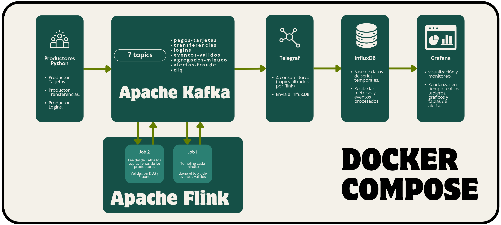

# Pipeline de streaming financiero: detección de fraude en tiempo real

Simulación de un sistema de monitoreo de transacciones bancarias. Los productores generan pagos, transferencias e inicios de sesión; Kafka los recibe, Flink los valida, calcula agregados por minuto y detecta fraude, Telegraf los lleva a InfluxDB y Grafana los muestra en vivo.


## Arquitectura



El proyecto se puede ejecutar de forma local mediante docker o en la nube de azure con una VM creada con Terraform y configurada con Ansible.

## Estructura del repositorio

```
├── docker-compose.yml        # Todo el stack
├── .env.example              # Plantilla de variables (el .env real no se sube)
├── kafka/                    # Script que crea los topics
├── productores/              # Productores en Python
├── flink/                    # Dockerfile y jobs de Flink
├── telegraf/                 # Configuración de Telegraf
├── grafana/                  # Datasource y dashboard (provisioning)
├── pruebas/                  # Scripts de latencia y mensajes malformados
├── terraform/                # Infraestructura en Azure (VM, red, firewall)
├── ansible/                  # Configuración de la VM (Docker y despliegue del stack)
├── Vagrantfile               # Nodo de control con Terraform, Ansible y Azure CLI
└── script.sh                 # Instala las herramientas en el nodo de control
```

## Variables de entorno

Antes de cualquier opción, crea tu `.env` a partir de la plantilla:

```bash
cp .env.example .env
```

| Variable | Qué es |
|---|---|
| `INFLUX_PASSWORD` | Contraseña del usuario `admin` de InfluxDB |
| `INFLUX_TOKEN` | Token de acceso a InfluxDB (usado por InfluxDB, Telegraf y Grafana) |
| `TASA_TARJETAS` | Eventos por segundo del productor de pagos |
| `TASA_TRANSFERENCIAS` | Eventos por segundo del productor de transferencias |
| `TASA_LOGINS` | Eventos por segundo del productor de logins |


---

## Para la ejecución local:

### Requisitos
- Docker Desktop con al menos **8 GB de RAM** asignados
- Git

### Pasos
```bash
git clone <URL-DEL-REPO>
cd <carpeta>
cp .env.example .env
docker compose up -d --build
```

### Servicios y URLs (local)
| Servicio | URL |
|---|---|
| Kafka UI | http://localhost:8080 |
| Flink | http://localhost:8081 |
| Grafana | http://localhost:3000 (usuario y contraseña:admin) |
| InfluxDB | http://localhost:8086 (usuario:admin  contraseña:admin1234)|

---

## Para ejecutarlo con aprovisionamiento en Azure

Terraform crea la infraestructura en Azure (red, firewall, IP pública y una VM Ubuntu 22.04). Después ejecuta automáticamente un playbook de Ansible que instala Docker en la VM, copia el proyecto y levanta el stack con `docker compose up -d --build`.

Todo se lanza desde un nodo de control que es una VM local creada con Vagrant, que ya trae Terraform, Ansible y Azure CLI.

### Requisitos
- [VirtualBox](https://www.virtualbox.org/) y [Vagrant](https://www.vagrantup.com/)
- Una suscripción de Azure con cuota de vCPU suficiente
- Git
- El archivo `.env` creado (ver "Variables de entorno"). Terraform lo necesita para copiarlo a la VM

### Paso 1. Levantar el nodo de control
Desde la raíz del repositorio:

```bash
vagrant up
vagrant ssh
```

El primer `vagrant up` tarda varios minutos: instala Terraform, Ansible y Azure CLI, y genera la llave SSH `~/.ssh/azure_key` que se usará para entrar a la VM de Azure. La carpeta del repositorio queda disponible dentro del nodo en `/vagrant`.

### Paso 2. Iniciar sesión en Azure
Dentro del nodo de control (solo la primera vez):

```bash
az login --use-device-code
```

Abre el enlace que aparece, escribe el código y entra con tu cuenta. Si más adelante Terraform se queja de `subscription_id`, ejecuta:

```bash
export ARM_SUBSCRIPTION_ID=$(az account show --query id -o tsv)
```

### Paso 3. Crear la infraestructura y desplegar
```bash
cd /vagrant/terraform
terraform init      # descarga los proveedores
terraform plan      # muestra qué se va a crear
terraform apply     # escribe "yes" para confirmar
```

`terraform apply` hace todo en orden: crea la red, el firewall y la VM, escribe el inventario de Ansible (`ansible/inventory.ini`) y ejecuta el playbook. La primera vez tarda entre 10 y 20 minutos. La parte más lenta es la construcción de la imagen de Flink dentro de la VM.

Qué hace el playbook (`ansible/playbook.yml`):
1. Espera a que la VM responda por SSH.
2. Instala Docker y Docker Compose.
3. Copia `docker-compose.yml`, `.env` y las carpetas `kafka`, `productores`, `flink`, `telegraf` y `grafana` a `/opt/streaming`.
4. Ejecuta `docker compose up -d --build`.
5. Muestra el estado de los contenedores (`docker compose ps -a`).

Cuando los jobs de Flink ya existan, activa en el playbook `esperar_jobs_flink: true` para que Ansible verifique que los 2 jobs queden en `RUNNING`.

### Paso 4. Abrir los servicios
```bash
terraform output
```

Muestra la IP pública de la máquina virtual en azure, el comando SSH y las URLs:

| Servicio | URL |
|---|---|
| Grafana | `http://<IP>:3000` (admin / admin) |
| Kafka UI | `http://<IP>:8080` |
| Flink | `http://<IP>:8081` |
| InfluxDB | `http://<IP>:8086` (admin / admin1234)|

Para entrar a la VM y revisar los contenedores:

```bash
ssh -i ~/.ssh/azure_key azureuser@<IP>
cd /opt/streaming
docker compose ps
docker compose logs -f <servicio>
```

### Actualizar el despliegue después de cambios
Si modificas el compose, el `.env`, el playbook o cualquier archivo de `kafka/`, `productores/`, `flink/`, `telegraf/` o `grafana/`, basta con volver a ejecutar:

```bash
cd /vagrant/terraform
terraform apply
```

Terraform detecta el cambio y repite el despliegue con Ansible.

### Apagar y borrar (cuidado con los costos)
| Acción | Comando |
|---|---|
| Pausar la VM (deja de cobrar cómputo; la IP estática sigue costando poco) | `az vm deallocate -g rg-streaming-fraude -n vm-streaming` |
| Reanudar la VM | `az vm start -g rg-streaming-fraude -n vm-streaming` |
| Borrar todo (VM, red, IP, disco) | `terraform destroy` |
| Apagar el nodo de control | `vagrant halt` |

---

## Comandos útiles (Docker Compose)
Funcionan igual en local y dentro de la VM de Azure (en `/opt/streaming`).

| Qué | Comando |
|---|---|
| Estado de los servicios | `docker compose ps` |
| Logs de un servicio | `docker compose logs -f <servicio>` |
| Memoria y CPU por contenedor | `docker stats --no-stream` |
| Apagar | `docker compose down` |
| Apagar y borrar datos | `docker compose down -v` |

## Topics de Kafka

Los crea automáticamente el servicio `kafka-init` (3 particiones, retención de 24 h).

| Topic | Escribe | Lee | Contenido |
|---|---|---|---|
| `pagos-tarjeta` | Productor de tarjetas | Job 2 de Flink | Pagos crudos |
| `transferencias` | Productor de transferencias | Job 2 de Flink | Transferencias crudas |
| `logins` | Productor de logins | Job 2 de Flink | Inicios de sesión crudos |
| `eventos-validos` | Job 2 de Flink | Job 1 de Flink, Telegraf | Eventos que pasaron la validación |
| `agregados-minuto` | Job 1 de Flink | Telegraf | Conteo, promedio y máximo por minuto |
| `alertas-fraude` | Job 2 de Flink | Telegraf | Alertas de fraude |
| `dlq` | Job 2 de Flink | Telegraf | Mensajes mal formados con el motivo del error |

## Job flink

Apache Flink procesa los eventos a medida que llegan a Kafka, sin esperar a tener todos los datos. El proyecto tiene dos jobs escritos en Python, en la carpeta `flink/jobs/`. El servicio `flink-submit` los envía automáticamente al arrancar el stack, y se pueden ver en la interfaz de Flink: http://localhost:8081.
 
| | Job 2 | Job 1 |
|---|---|---|
| **Archivo** | `job_fraude.py` | `job_agregaciones.py` |
| **Nombre en Flink** | `job2-fraude-dlq` | `job1-agregaciones` |
| **Lee de** | `pagos-tarjeta`, `transferencias`, `logins` | `eventos-validos` |
| **Escribe en** | `eventos-validos`, `alertas-fraude`, `dlq` | `agregados-minuto` |
| **Qué hace** | Valida cada mensaje, detecta fraude y aparta los mensajes malos | Resume la actividad de cada minuto |