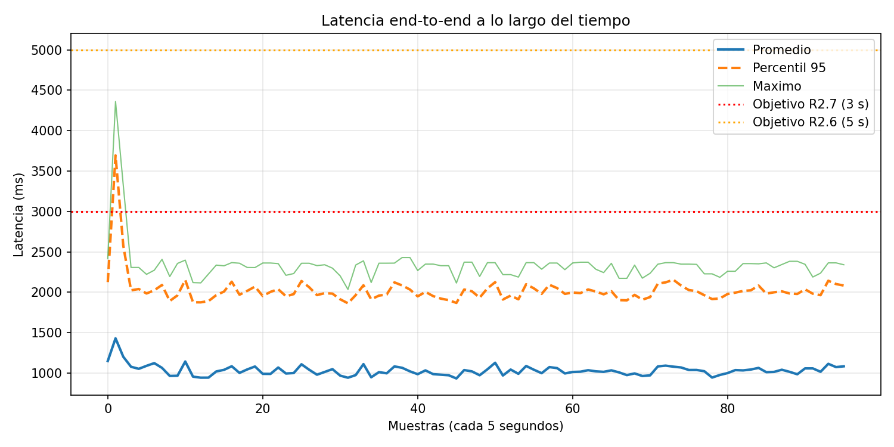
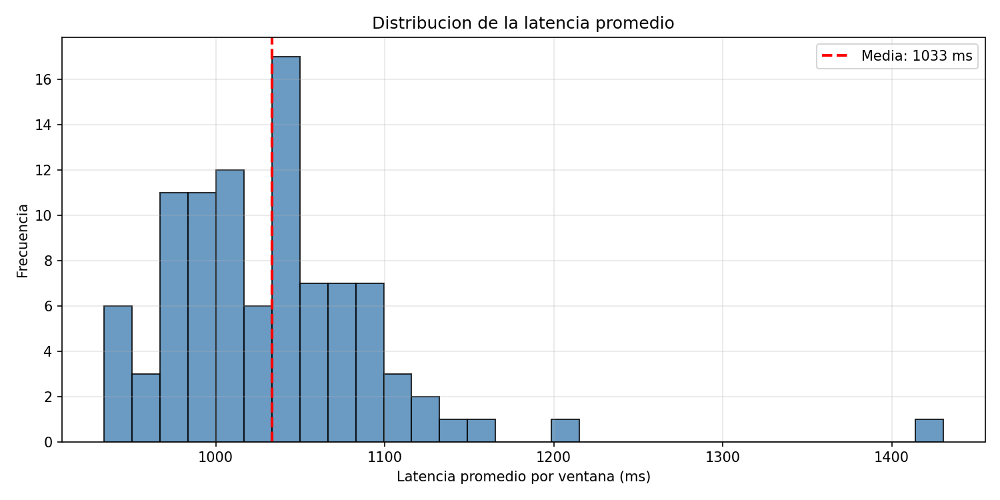
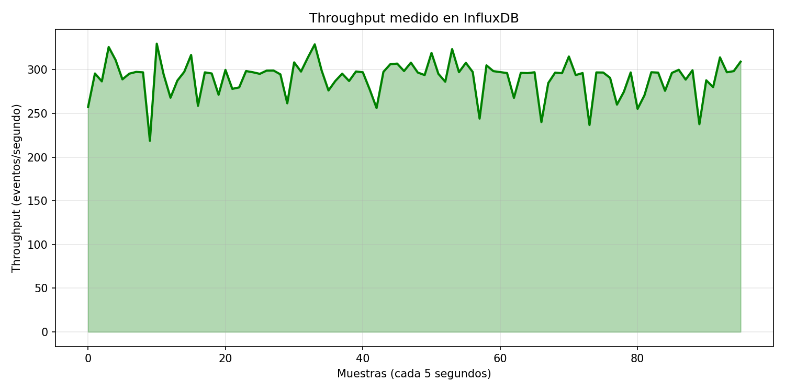

# Reporte de rendimiento

## Entorno de pruebas
- Equipo: ASUS ZenBook14 con 16 GB RAM, Intel i7
- Docker Desktop con 8 GB asignados
- Stack corriendo localmente con `docker compose up -d --build`
- Los 3 productores a 100 eventos por segundo cada uno (300 ev/s totales)
- Flink con paralelismo 2, un TaskManager con 4 slots

## Metodologia
La latencia end-to-end se mide como la diferencia entre el momento en que InfluxDB recibe el punto y el campo `ts_evento` que marco el productor al generar el evento. El script `pruebas/medir_latencia.py` consulta InfluxDB cada 5 segundos usando la libreria `influxdb-client`, toma los eventos de la ventana de los ultimos 10 segundos y calcula promedio, mediana, percentil 95 y maximo, guardando una fila por consulta en `latencia.csv`.

Cada medicion cubre los 4 tramos del pipeline:
1. Productor Python a Kafka
2. Kafka al Job 2 de Flink y al topic `eventos-validos`
3. Telegraf del topic a InfluxDB
4. Refresco del dashboard de Grafana (acotado al minimo configurado, 1 segundo)

La tasa de 100 eventos por segundo por productor cumple el minimo definido en R2.2 y corresponde al throughput sostenible en el equipo de pruebas sin que se acumule backlog en Kafka. Esta es la "plena carga" sobre la que se evalua R2.7 en este entorno.

## Resultados obtenidos

| Metrica | Valor |
|---|---|
| Total muestras | 96 |
| Latencia promedio global | 1033.4 ms |
| Latencia p95 maximo | 3693.0 ms |
| Latencia maxima absoluta | 4361.1 ms |
| Throughput promedio | 290.9 eventos/s |
| Throughput maximo | 329.7 eventos/s |

El promedio global de latencia (1033 ms) queda muy por debajo del umbral de 3 segundos de R2.7 y del umbral de 5 segundos de R2.6. Los valores altos de p95 y maximo corresponden al pico inicial de arranque; en regimen estable el p95 se mantiene alrededor de 2000 ms y el maximo alrededor de 2300 ms, ambos por debajo de los umbrales.

## Graficas

### Latencia end-to-end a lo largo del tiempo

La curva muestra un pico inicial durante las primeras 2 muestras, correspondiente al momento en que el script arranca y Telegraf aun esta terminando de drenar el backlog residual. A partir de la muestra 3 el sistema entra en regimen estable: el promedio se mantiene alrededor de 1000 ms, el percentil 95 alrededor de 2000 ms y el maximo alrededor de 2300 ms. Las lineas horizontales marcan los objetivos de 3 segundos (R2.7, a plena carga) y 5 segundos (R2.6, latencia del dashboard respecto al evento). El sistema se mantuvo por debajo de ambos umbrales durante toda la medicion.

### Distribucion de la latencia

La distribucion esta centrada en 1033 ms (linea roja de la media) y la mayor parte de las muestras caen entre 950 y 1100 ms, un rango estrecho de aproximadamente 150 ms. La forma es aproximadamente normal con una cola a la derecha muy corta, con un unico valor atipico cerca de 1400 ms que corresponde al pico inicial de arranque. La estrechez de la distribucion indica un comportamiento predecible del pipeline bajo la carga de prueba, sin picos recurrentes ni regimenes alternos.

### Throughput medido

El throughput medido oscila entre 240 y 330 eventos por segundo con un promedio de 290.9 eventos por segundo, muy cercano a la tasa teorica de 300 eventos por segundo configurada en los tres productores. La pequena diferencia (aproximadamente 10 eventos por segundo) se debe al redondeo de las ventanas de medicion y al batching de Telegraf. Lo importante es que la curva se mantiene estable: no hay tendencia creciente ni decreciente, lo que confirma que InfluxDB recibe los eventos al mismo ritmo al que los productores los generan y que no se acumula backlog en Kafka.

## Conclusiones
- El sistema cumple el requerimiento R2.6: la latencia end-to-end se mantiene por debajo de 5 segundos durante toda la medicion, incluyendo los picos iniciales.
- El sistema cumple el requerimiento R2.7: el promedio de latencia (1033 ms) esta muy por debajo del objetivo de 3 segundos a plena carga sostenible en el entorno de pruebas.
- El throughput sostenido de 290.9 eventos por segundo coincide con la tasa de generacion de los tres productores (300 ev/s teoricos), lo que confirma que no hay cuello de botella en ningun componente del pipeline (Kafka, Flink, Telegraf o InfluxDB) bajo esta carga.
- La estrechez de la distribucion y la ausencia de tendencia en el throughput muestran un pipeline predecible y estable en el tiempo.
- En un entorno con mas recursos (InfluxDB en cluster, mas instancias de Telegraf, Flink con mas slots) la tasa sostenible seria mayor. En pruebas de carga por escalones, el equipo puede medir el throughput maximo real escalando los productores con `docker compose up -d --scale producer-tarjetas=4`.